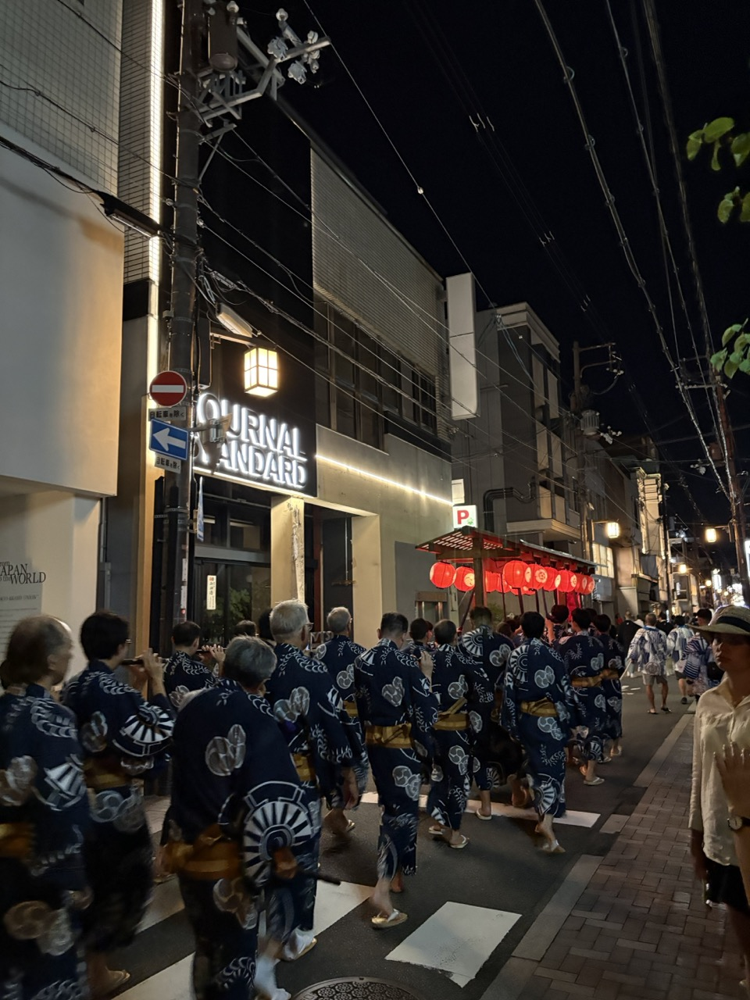
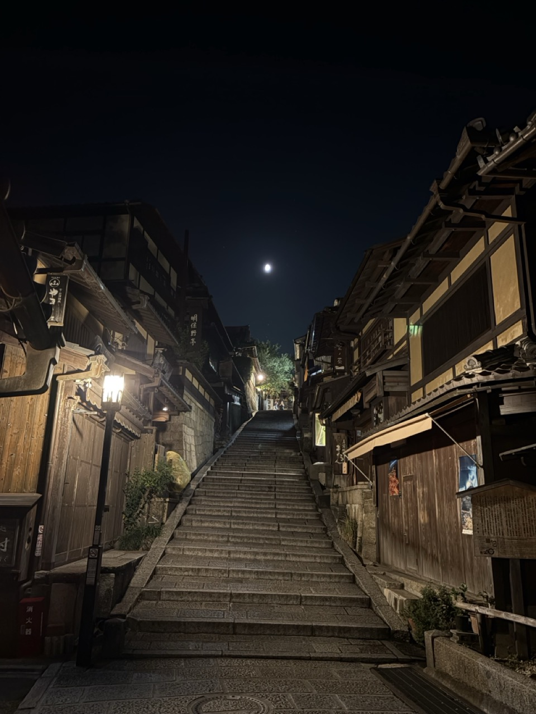
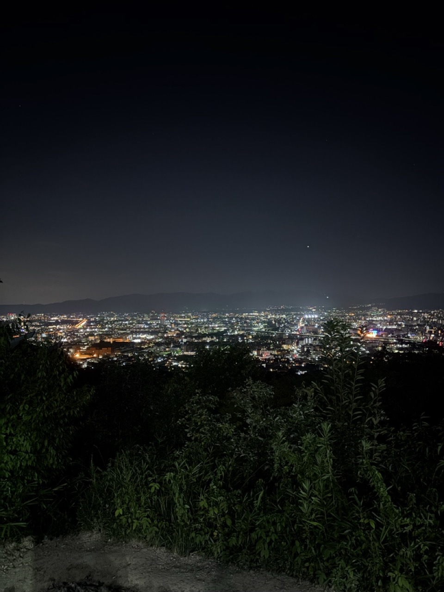
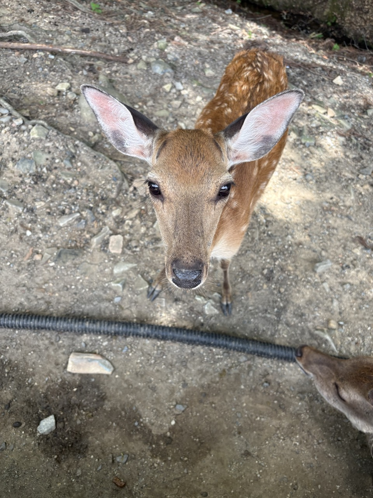
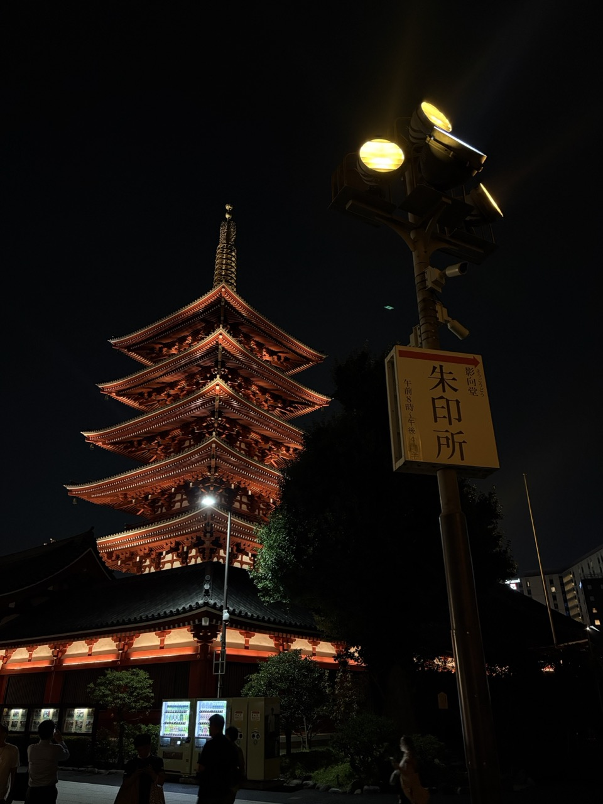
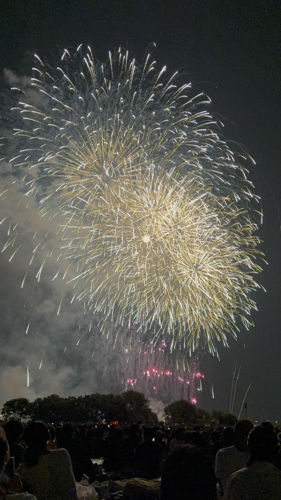
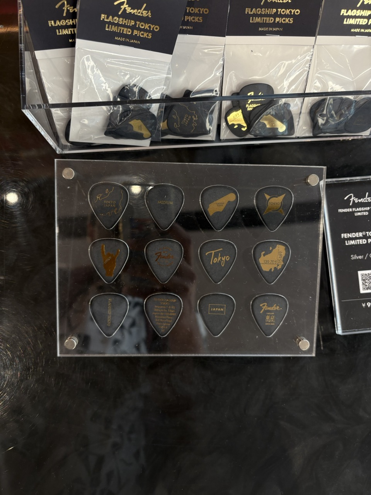
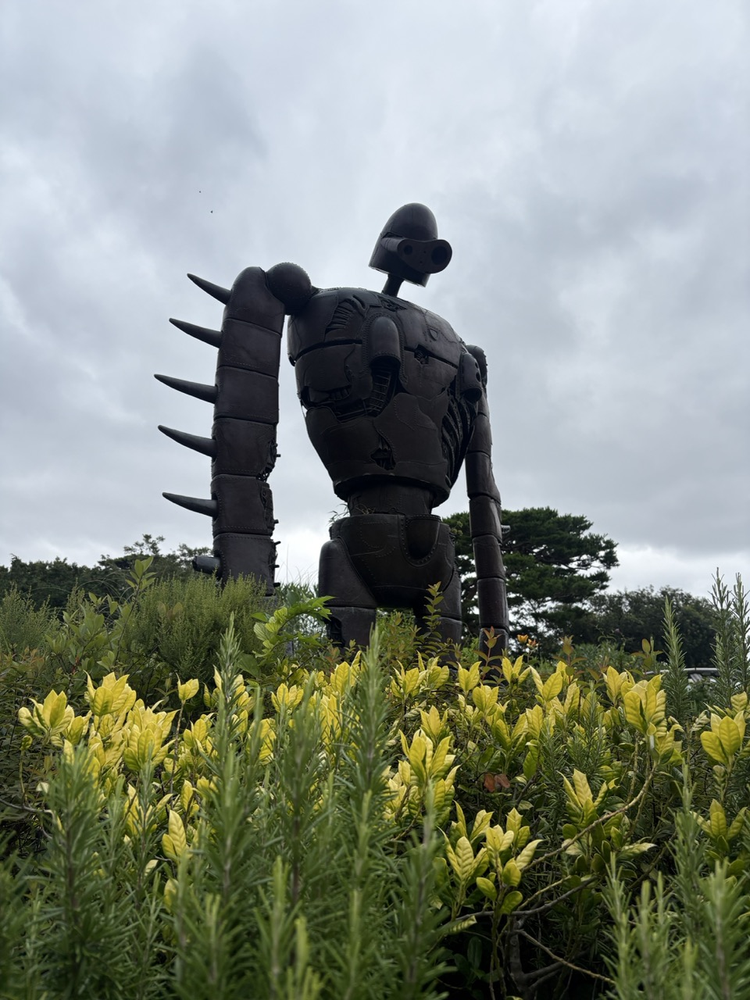
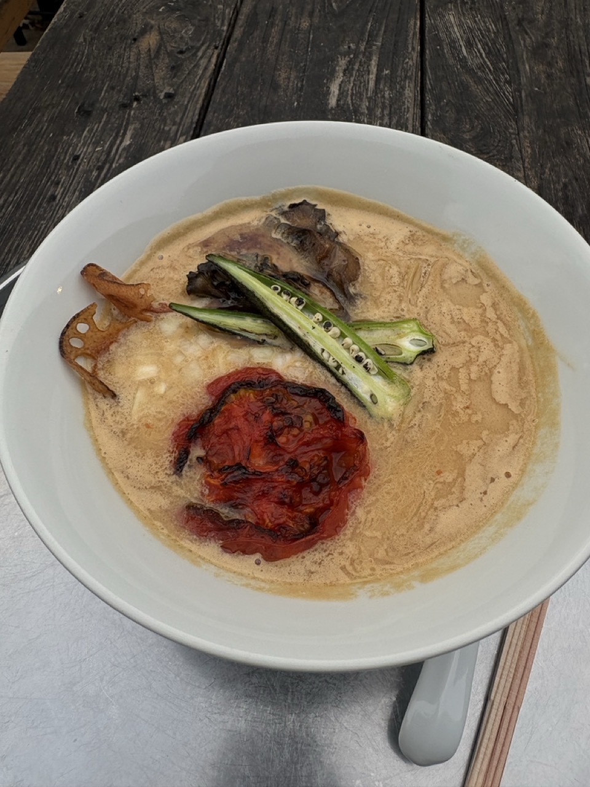
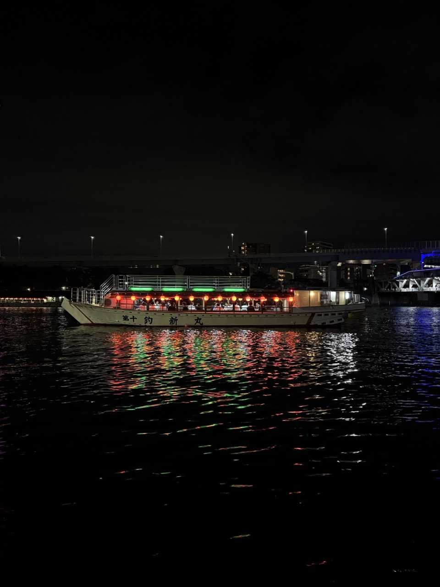

In July and August of 2026 I spent a couple of weeks in Japan, starting in Kyoto and ending in Tokyo. This is a day-by-day record of what I did, partly for me so I can come back and reminisce on the trip, and partly for someone else who might be looking for recommendations to plan theirs :)

<!--more-->

# Thursday, 23rd July

Landed at Haneda at 6:45 AM. Train to Shinagawa, then the Shinkansen to Kyoto. Checked in at Piece Hostel Sanjo.

Had food at [Nijiya](https://maps.app.goo.gl/MgXX52j2xUEMyhBa7) and roamed around the nearby areas. Shopped at Uniqlo.

In the evening, saw the Yoiyama night processions.

# Friday, 24th July

First 7/11 run in the afternoon. Brought food back to the hostel and ate there. The egg sandwiches were a highlight.

Left again around 7pm. The route for the evening: Yasaka Shrine → Kōdaiji Temple → the bamboo graves near it (a special night light experience was going on) → a food truck type thing near there → Ninenzaka → Sannenzaka → Kiyomizu-dera (from outside only) → back to the hostel. Saw some more processions on the way back.

# Saturday, 25th July

Around 1pm went to a nearby Don Quijote and picked up Biore UV Aqua Rich sunscreen and Attack on Titan themed playing cards.

Around 2pm walked to Nijo Castle. Too hot to do the whole thing, so I just saw the main hall with the nightingale sound floor.

Back to the hostel to rest. Around 7pm took the subway to Fushimi Inari and went all the way to the hilltop.

# Sunday, 26th July

Left the hostel around 8am and reached Nara Park around 10am. Saw the deer, then Todai-ji, then Kasuga Taisha. The walk from Todai-ji to Kasuga Taisha was beautiful. Stopped at a restaurant midway to rest from the heat and have a pizza.

Came back around 2pm and rested till 6pm. From 7 to 9pm roamed aimlessly, visited the Hands outlet, and finally found a veg ramen at a 7/11 and had it (it was spicy af).

Around 10pm walked by Pontocho Alley and then sat by the Kamo River. Great vibe.

# Friday, 31st July (Ueno + Asakusa)

Reached Tokyo around 3pm. Checked into Hotel MONday Asakusa and slept till 4pm.

Walked to the Tokyo National Museum and was there from 5 to 8pm. Spent some time around the museum area after that. Had soba noodles at some place in Ueno (they were mid).

Took the train to Asakusa to see Sensō-ji at night. 10/10, would recommend. From there walked to the Sumida River and spent some time there. Back to the hotel.

# Saturday, 1st August (Akihabara)

Went to Akihabara at 12:15pm. Spent about two hours at Yodobashi Akiba. Saw the bridge from Steins;Gate right outside the station.

Wandered into whatever shop piqued my curiosity (saw lots of cool action figurines). Went to Super Potato and played retro games. Then Radio Kaikan, the one the time machine crashes into in Steins;Gate's opening, plus the Yellow Submarine RPG shop inside.

Went to see the place that's supposed to be Okabe's lab but didn't find it. Saw something that looked similar at the "PC shop EYES". Then Cafe Mai:lish, the actual maid café where Mayuri works in Steins;Gate.

Train from Akihabara to Koiwa. Saw the Edogawa Fireworks Festival along the banks of the Edogawa River. These fireworks were probably the highlight of my trip. Back to Asakusa.

# Sunday, 2nd August (Shibuya)

Reached Meiji Shrine around 12pm. Walked around and saw the well area too. Exited the shrine into Takeshita Street and did some random shopping. Went to Fender's signature store. Random window shopping at Cat Street.

Shibuya Crossing and Shibuya Sky around 5pm. Went to the famous Tsutaya Books in Daikanyama. The shop was cool but didn't feel worth going that far.

Dinner at Shinbu Sakiya Ramen. Shopping at Mega Don Quijote Shibuya.

# Monday, 3rd August (Mitaka, Kichijoji, Shinjuku)

Went to the Ghibli Museum in Mitaka. Spent time at Inokashira Park (would recommend!), then exited on the Kichijoji side and went to Sugorokuya (a board games shop).

Went to Shinjuku. Shopped at the Sports Depo Shinjuku flagship store. Walked around towards the Godzilla Head. Strolled around Golden Gai.

# Tuesday, 4th August

Went for teamLab Planets, entry time was 4pm. Reached around 2:30pm, went to a mall nearby, and then spent time by the riverside that comes on the way to teamLab when walking from the station.

Had really good vegan ramen at teamLab Planets (best ramen I had on the trip, though I'm a vegetarian so take that with a pinch of salt). Went to Ginza after.

# Wednesday, 5th August

Shopping day in Ginza. Went to Onitsuka, Uniqlo, and Itoya. Got vegan noodles at a Lawson in Ginza.

Got back around 6pm and rested at the hotel. Went to Sensō-ji and the Sumida River again till night.

# Thursday, 6th August

Nice breakfast at tAnuu KITCHEN before leaving for Narita Airport.
